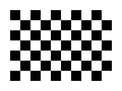
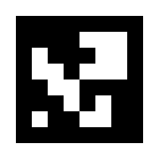
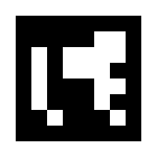
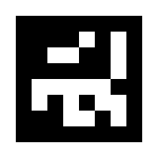

# Spot Challenge - Marker Test Guide (Windows)

This guide shows you how to set up the camera and test ArUco markers. **You do not need to write or change any code.** You only copy commands, paste them into the Command Prompt and press Enter.

**Part A** uses the laptop webcam (practice). **Part B** uses the Tello's downward camera. **The drone never takes off in this guide.** The motors stay off.

## What you need

1. Internet and a web browser (to download the kit)
2. A printer (A4 paper), a ruler, a measuring tape
3. Flat cardboard and glue or tape
4. A laptop with a webcam and internet (for step 2)
5. A charged Tello drone (the downward camera needs **Tello EDU / Tello TT**)

## Important values (keep this page)

| Item | Value | File to print |
|---|---|---|
| Chessboard | 10 x 7 squares (9 x 6 inner corners)<br>square size = 21 mm | print/chessboard_10x7_21mm_A4.pdf |
| ArUco markers | Dictionary (family): DICT_6X6_250<br>IDs: 0, 1, 2<br>black square = 150 mm | print/aruco_DICT_6X6_250_id0-2_150mm_A4.pdf |

   

## How to run a command

1. Copy one grey command box, paste it into the Command Prompt, press **Enter**.
2. A program opens a window. To close it: click on the window and press **Q**.
3. If a command shows red error text, look at "Problems and fixes" at the end.

---

# Step 0 - Download the kit

1. Open this link in a web browser: **https://github.com/chissanupong-s/Spot_challenge_fidutial_marker**
2. Click the green **"<> Code"** button, then click **"Download ZIP"**.
3. Open your **Downloads** folder. Right-click `Spot_challenge_fidutial_marker-main.zip` and choose **"Extract All..."**, then click **"Extract"**.
4. Move the unzipped folder `Spot_challenge_fidutial_marker-main` to your Desktop (easy to find).
5. Windows often puts a folder inside a folder with the same name. Open folders until you see the files `GUIDE_Windows.pdf` and `requirements.txt` - that is the kit folder.
6. Open it. You should see the guides, a `print` folder and a `scripts` folder.

> **Important:** Always work inside the unzipped folder, not inside the .zip file.

# Step 1 - Print

1. Open `print/chessboard_10x7_21mm_A4.pdf` and `print/aruco_DICT_6X6_250_id0-2_150mm_A4.pdf`.
2. In the print window choose **"Actual size"** or **"100%"**. Do NOT choose "Fit to page".
3. **Measure with a ruler:** one chessboard square should be **21 mm**. The black ArUco square should be **150 mm**.
4. **Write down what you measured.** If it is a bit different (for example 20.5 mm), that is OK - you will type your measured number later.
5. Glue the chessboard **flat** on cardboard. It must not bend.
6. Cut the markers on the dashed line. **Keep the white border** around the black square. Do not fold them.

> **Note:** Meters = millimeters / 1000. Example: 21 mm = 0.021, 20.5 mm = 0.0205, 150 mm = 0.15.

# Step 2 - Install (only once)

> **Important:** Do this while the laptop is connected to the normal internet (not the Tello Wi-Fi).

1. Download Python 3.12 from **python.org/downloads** and run the installer.
2. On the first screen **tick "Add python.exe to PATH"**, then click "Install Now".
3. Open the folder `Spot_challenge_fidutial_marker-main` (from Step 0).
4. Click the address bar at the top of the folder window, type `cmd` and press Enter. A black window (Command Prompt) opens in this folder. Use Command Prompt, not PowerShell.
5. Paste these commands one by one:

```
python -m venv .venv
.venv\Scripts\activate
python -m pip install --upgrade pip
pip install -r requirements.txt
```

When you see **(.venv)** at the start of the line, you are ready.

> **Important:** Every time you open a new Command Prompt: open it in the kit folder (as above) and run this first:

```
.venv\Scripts\activate
```

---

# Part A - Laptop webcam

## Step 3 - Find the camera ID

A laptop can have more than one camera. Each camera has a number (ID): 0, 1, 2 ...

```
python -m scripts.aruco.check_cameras
```

1. A window shows the camera image with **CAMERA ID = 0**.
2. Press **N** to see the next camera. Press **Q** to close.
3. **Write down the ID** of the camera you want (usually 0 = built-in, 1 = USB camera).
4. In the next commands, replace `--camera-id 0` with your ID.

## Step 4 - Take chessboard photos

```
python -m scripts.aruco.capture_calibration_images --camera webcam --camera-id 0
```

1. Hold the chessboard in front of the camera.
2. Green text **"BOARD FOUND"** = good: hold still and press **SPACE** to save a photo.
3. Red text = the camera cannot see the whole board. Move it until the text is green.
4. Take **20 to 30 photos**: near and far, tilted left / right / up / down, and in every corner of the picture.
5. Use good light. Avoid shiny reflections on the board.
6. Press **Q** when done.

## Step 5 - Calibrate the webcam

```
python -m scripts.aruco.calibrate_camera --camera webcam --square-size 0.021
```

1. `--square-size` = **your measured square size in meters** (21 mm = 0.021).
2. Wait until it prints **"Calibration complete."**
3. Look at the line **"Mean reprojection error (pixels)"**: below 0.5 = great, below 1.0 = OK, above 1.0 = do Step 4 again (first delete the photos in `data/calib_images/webcam`).
4. The result is saved automatically in `assets/calibration/webcam`. You do not need to copy anything.

## Step 6 - Test the printed markers

```
python -m scripts.aruco.webcam_distance --camera-id 0 --marker-length 0.15
```

1. `--marker-length` = **your measured black square in meters** (150 mm = 0.15).
2. Hold marker ID 0 in front of the camera. You see a green outline, colored axes and text like **"ID: 0 | Z: 0.503 m"**. Z = distance from the camera in meters.
3. Check it: put the marker **50 cm** and **100 cm** from the camera (use the tape). Z should be close (within about 2-3 cm). Write the numbers in the results table.
4. Try markers ID 1 and ID 2 too. Press **Q** to close.

---

# Part B - Tello downward camera

> **Important:** The drone does NOT take off in these steps. Hold it in your hand or put it on a box. Use a fully charged battery.

## Step 7 - Connect and first test

1. Turn on the Tello and wait about 10 seconds.
2. Connect the laptop Wi-Fi to **TELLO-XXXXXX**. (No internet now - that is normal.)
3. If Windows asks **"Allow access"** (Firewall) for Python: tick **both** boxes (Private and Public) and click Allow. Without this you get no video.
4. Open the Command Prompt in the kit folder, run `.venv\Scripts\activate`, then:

```
python -m scripts.tello.marker_test --camera down
```

1. A small grey picture appears - this is the camera under the drone.
2. Put a marker on the floor. Hold the drone 30-50 cm above it, camera facing down.
3. You see a green outline and text like **"ID:0 area:5200px"**.
4. "Calibration: NO" is normal now - distance comes after Step 9.
5. Press **V** to switch to the front camera and back. Press **Q** to close.

> **Important:** If you see "Tello rejected the camera switch": this drone cannot use the downward camera (it needs Tello EDU / TT). Stop here and tell the dev team.

## Step 8 - Chessboard photos with the downward camera

```
python -m scripts.aruco.capture_calibration_images --camera tello_down
```

1. Put the chessboard flat on the floor or a table, in good light.
2. Hold the drone above it, camera facing down, about 30-60 cm high.
3. This time **move and tilt the drone**, not the board.
4. Same rules as Step 4: green "BOARD FOUND" -> press **SPACE**. Take **20 to 30 photos**. Press **Q** when done.

## Step 9 - Calibrate the downward camera

```
python -m scripts.aruco.calibrate_camera --camera tello_down --square-size 0.021
```

Check the "Mean reprojection error" the same way as Step 5. The result is saved in `assets/calibration/tello_down`.

## Step 10 - Test markers with distance

```
python -m scripts.tello.marker_test --camera down --marker-length 0.15
```

1. Now the screen says **"Calibration: yes"** and shows **z** in meters.
2. Hold the drone **30 cm, 50 cm and 100 cm** above the marker (measure from the camera to the floor). Write down z each time.
3. Press **S** to save a picture at each height.
4. Try markers ID 1 and ID 2, and a marker near the edge of the picture.

## Step 11 - Send the results to the dev team

Zip these and send them:

1. the folder `assets/calibration`
2. the folder `data/snapshots`
3. your results table (a photo of the paper is fine)

| Camera | Marker ID | Real distance | Screen Z / z | OK? |
|---|---|---|---|---|
| Webcam | 0 | 50 cm |  |  |
| Webcam | 0 | 100 cm |  |  |
| Tello down | 0 | 30 cm |  |  |
| Tello down | 0 | 50 cm |  |  |
| Tello down | 0 | 100 cm |  |  |
|  |  |  |  |  |

---

# Problems and fixes

| Problem | Fix |
|---|---|
| 'python' is not recognized | Install Python again and tick "Add python.exe to PATH". Or type py instead of python. |
| No module named 'cv2' or 'djitellopy' | You forgot to activate. Run: .venv\Scripts\activate |
| No module named 'scripts' | The Command Prompt is not in the kit folder. Open it in the folder again. |
| Camera window is black / does not open | Close Zoom, Teams, browser camera tabs. Try another camera ID. |
| Text never turns green (Step 4 / 8) | More light, board flat, the WHOLE board in the picture, no reflections, hold still. |
| "Only N valid calibration images" | Take more photos (Step 4 / 8), then calibrate again. |
| "Calibration file not found" | Do the calibrate step (Step 5 / 9) first. |
| Marker is not detected | Show the whole marker with its white border. Keep it flat. Come closer. More light. Only the printed markers from this kit work. |
| WARNING: calibration ... does not fit | The calibration was made with another camera. Redo the photos + calibrate steps for this camera. |
| Tello: no picture / stuck | Is the Wi-Fi connected to TELLO-XXXXXX? Turn the drone off and on, wait 10 s, try again. Allow Python in the Windows Firewall. |
